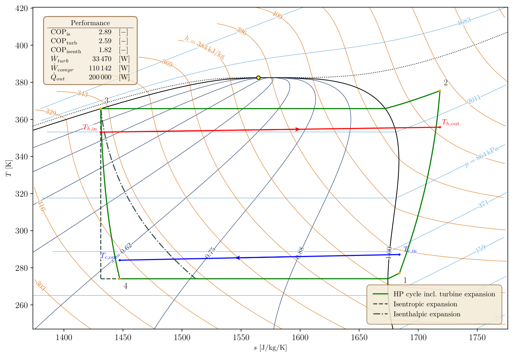
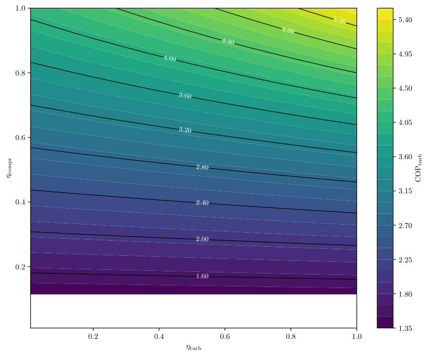

# Conceptual Heat Pump Cycle (CHPC)

This tool identifies the vapour-compression cycle with maximum COP for a given set of heat source and heat sink characteristics, heat exchanger pinch-point constraints, component efficiencies and refrigerant. The cycle is a single-stage vapour-compression cycle in which the expansion valve is replaced by a turbine expander. It follows from a differential evolution optimization of the compressor pressure ratio, the temperature and entropy at the compressor inlet, and the temperature at the condenser outlet, subject to the pinch-point constraints of the evaporator and condenser. The figure below shows the resulting cycle of R1234ze(E), together with the expansion through an isentropic turbine and through an expansion valve. The diagram background is generated with [thermoplot](https://github.com/mths-mhln/thermoplot), of which a local copy is included in `src/thermoplot`.



## Dependencies

- Python 3.13 or newer
- CoolProp, matplotlib, numpy, rich and scipy, see `pyproject.toml`. The exact versions are recorded in `uv.lock`.
- NIST REFPROP. All thermodynamic properties are extracted from REFPROP through CoolProp, hence a REFPROP licence and installation are necessary.
- A LaTeX installation, which is used for the text in the diagrams.

## Installation

Clone the repository, create a virtual environment with [uv](https://docs.astral.sh/uv/) and install the tool in editable mode, which makes both `CHPC` and the local copy of `thermoplot` importable:

```bash
git clone https://github.com/mths-mhln/conceptual_heat_pump_performance_evaluation.git
cd conceptual_heat_pump_performance_evaluation
uv venv
.venv\Scripts\activate
uv pip install -e .
```

On Linux and macOS the environment is activated with `source .venv/bin/activate`.

## How to run

Running the tool and post-processing its results are separated. `main.py` runs the analysis specified in the config file at the top of the script, and saves the results as `.npz` files in `results/`. Afterwards, `postprocess.py` makes the diagrams from these files:

```bash
python main.py
python postprocess.py
```

Before the analysis, `main.py` verifies the model against pocketTHERM for three heat pump cycles (see `test/system_tests`), which can be switched off with `perform_verification=False` at the bottom of `main.py`. Every refrigerant folder in `config/` contains two config files:

| Config file | Analysis | Results |
| --- | --- | --- |
| `CHPC.ini` | optimizes a single cycle and prints its performance parameters | T-s, p-h and optimizer progress diagrams in `results/heat_pump_thermodynamic_diagrams/<refrigerant>/` |
| `COP_vs_eff.ini` | optimizes the cycle for a grid of turbine and compressor efficiencies | COP maps in `results/COP_investigations/<refrigerant>/` |

The COP sweep saves its progress every 5 cycles, and can be continued after an interruption. The figure below shows the COP map of R1234ze(E).



The cycle calculation method is selected with `calculation_method`. `full_optimization` optimizes the four variables above, `fixed_PR` optimizes the compressor inlet state and the condenser outlet temperature at a given pressure ratio, and `three_temp_fix` fixes four temperature differences and only optimizes the pressure ratio (the approach of `00_thermodynamics_legacy/thermodynamics_legacy_4.py`). Results of the latter two methods carry the method in their file name, e.g. `COP_vs_eff_R1234ze(E)_COP_turb_three_temp_fix.npz`, such that the methods can be compared with

```bash
python thermodyanmics_calculation_methods_comparison/thermodynamics_calculation_methods_comparison.py --data-dir "results/COP_investigations/R1234ze(E)/data"
```

`postprocess.py` also contains the empty T-s and p-h diagrams of a substance, the effect of the component efficiencies on the cycle and the COP maps of two refrigerants side by side. The margins around the cycle and the size of the optimizer progress figure are arguments of `make_cycle_plots`, and the diagram backgrounds are specified in `config/thermoplot/`.

## Input overview

The config file is an `.ini` file with the sections below, see `config/R1234ze(E)/CHPC.ini`. Inputs that are not used by the specified analysis type and calculation method must not be specified, e.g. `PR` for `full_optimization`.

| Input | Unit or values | Description |
| --- | --- | --- |
| **[ANALYSIS TYPE]** | | |
| `analysis_type` | `CHPC` or `COP_vs_eff` | single cycle, or cycles for a grid of efficiencies |
| `calculation_method` | `full_optimization` (default), `fixed_PR` or `three_temp_fix` | cycle calculation method |
| **[ANALYSIS SPECIFICATIONS]** | | |
| `refrigerant` | e.g. `R1234ze(E)`, `CO2` | working fluid, following the CoolProp naming convention |
| `T_h_in` | [K] | inlet temperature of the heat sink |
| `ṁ_h`, `cp_h` | [kg/s], [J/kg/K] | mass flow rate and specific heat capacity of the heat sink |
| `T_c_in` | [K] | inlet temperature of the heat source |
| `ṁ_c`, `cp_c` | [kg/s], [J/kg/K] | mass flow rate and specific heat capacity of the heat source |
| `η_turb`, `η_compr` | [-] | isentropic efficiency of the turbine and compressor, `CHPC` only |
| `η_shaft` | [-] | efficiency of the turbine/compressor shaft connection, default 1 |
| `ΔT_pp_min_evap`, `ΔT_pp_min_cond` | [K] | minimum pinch-point temperature difference in the evaporator and condenser, not for `three_temp_fix` |
| `Q_out_req` | [W] | required heat output, not for `three_temp_fix` |
| `PR` | [-] | compressor pressure ratio, `fixed_PR` only |
| `ΔT_pp_1`, `ΔT_pp_3`, `ΔT_pp_4`, `ΔT_sh` | [K] | temperature difference at the evaporator outlet, condenser outlet and evaporator inlet, and superheat, `three_temp_fix` only |
| **[COP VS EFF SETTINGS]** | | `COP_vs_eff` only |
| `η_turb_bounds`, `η_compr_bounds` | `[min, max]` | bounds of the turbine and compressor efficiency |
| `n_η` | integer, e.g. `20` | number of efficiencies, the bounds included |
| `existing_complete_sweep_action` | `prompt` (default), `abort` or `recompute` | behaviour when a complete sweep already exists |
| **[NUMERICS]** | | |
| `n_pts` | integer, default `150` | number of points along the isobars of the cycle |
